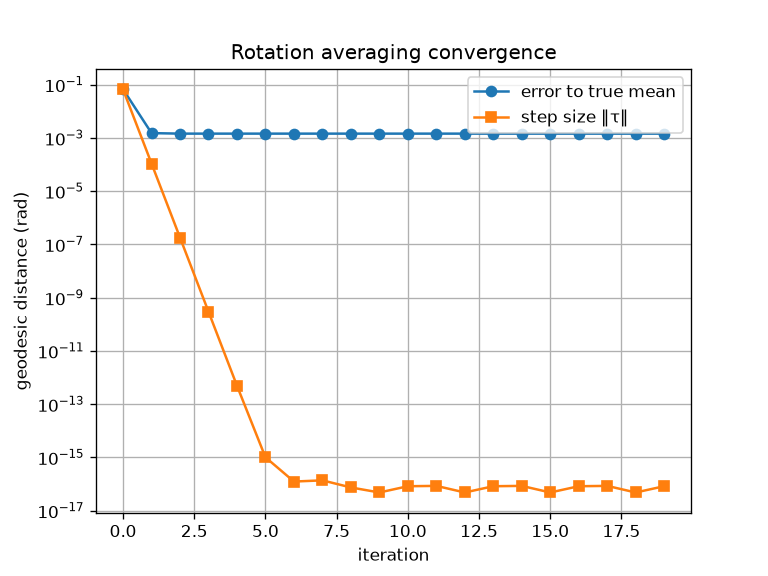

# tiny_lie

Toy implementation of the rotation Lie group, with two representations (matrices and quaternions).
A small educational implementation.

## Content

- Lie groups of 3D rotations, i.e. the group of rotation matrices SO(3), and the 3 sphere group of unit quaternions S^3.
- Exponential map, to each manifold from their respective Lie algebra. The inverse Log map.
- rplus/rminus for tangent-space operators,
- simple rotation averaging demo (Fréchet/Karcher mean) on both representations.

## Run

```bash
uv run pytest -v
uv run demo_rotation_averaging_SO3.py # SO(3) averaging + convergence plot
uv run demo_rotation_averaging_UnitQuaternion.py
```



## Notes

- Proper handling of numerical corner cases of Exp/Log/rminus/rplus (small angles with Taylor expansion and test aware of sign ambiguities at pi)

## References

Solà, Deray, Atchuthan, *A micro Lie theory for state estimation in robotics* (2018), arXiv:1812.01537.
